# 가위 (GAWI)

> 1998년 4월 4일, 밤 11시 44분. 여덟 살 **하나**는 가위에 눌렸다.
> 꿈속의 404호에는 사람을 세상에서 **오려 내는** 것이 산다.

자각몽과 가위눌림을 소재로 한 2D 픽셀 공포 게임입니다 (Unity).
*FAITH* 같은 아타리풍 저해상도 그래픽, 최소한의 색, 갑작스러운 소음, 그리고 단순한 픽셀로 그린 고어.

**이번 빌드: 「1장 · 404호」** — 처음부터 엔딩·크레딧까지 이어지는 완결 데모 (약 15~25분)

> ⚠️ 피, 신체 훼손, 아이가 위협받는 장면, 번쩍이는 화면이 나옵니다.
> 게임을 시작하면 경고 화면이 나오고, 설정에서 「번쩍임 줄이기」를 켤 수 있습니다.

| | | |
|:-:|:-:|:-:|
| 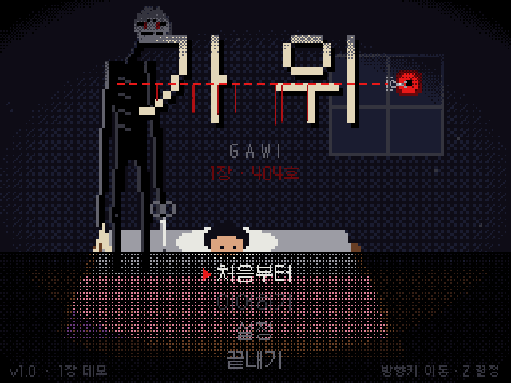 | 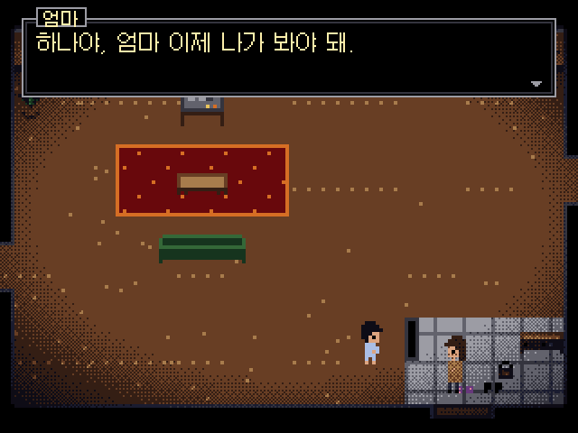 | 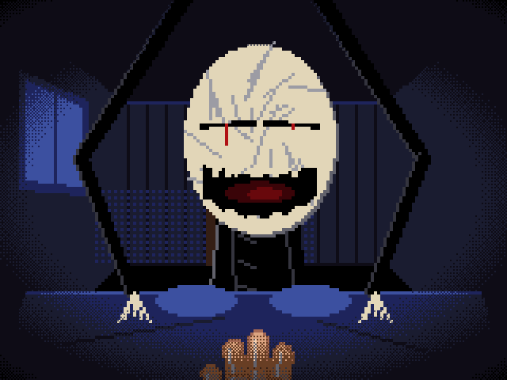 |
| 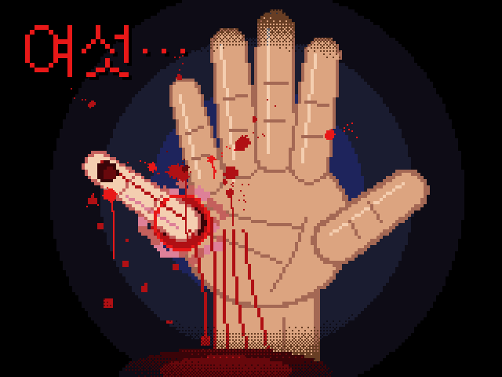 | 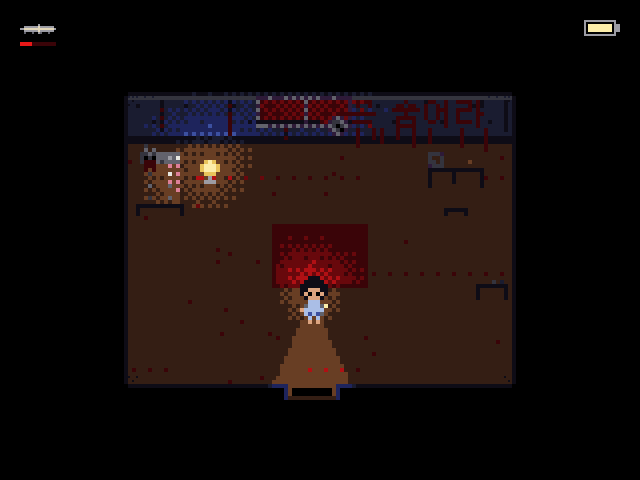 | 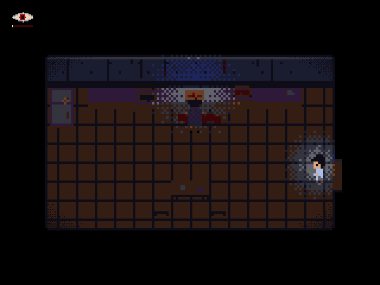 |

<details>
<summary>스크린샷 더 보기 (스포일러)</summary>

| | | |
|:-:|:-:|:-:|
| 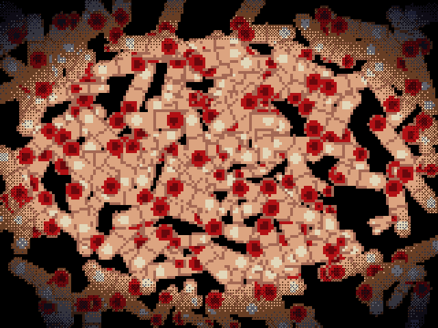 | 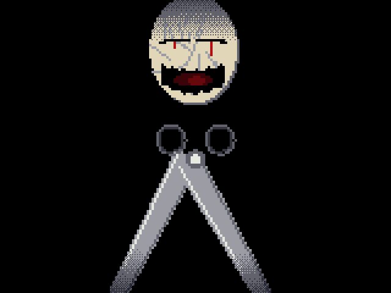 | 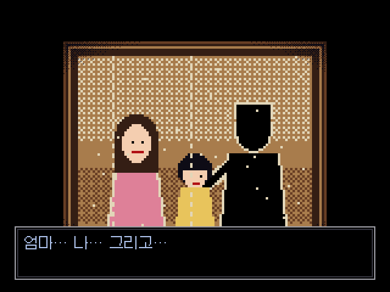 |
| 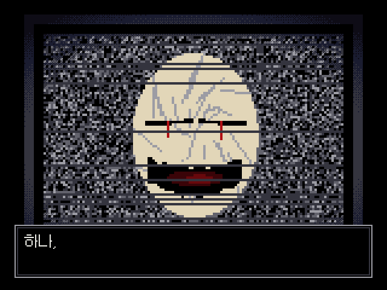 | 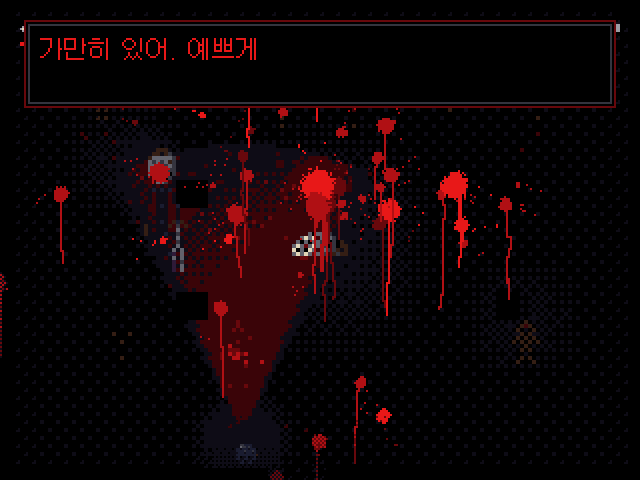 | 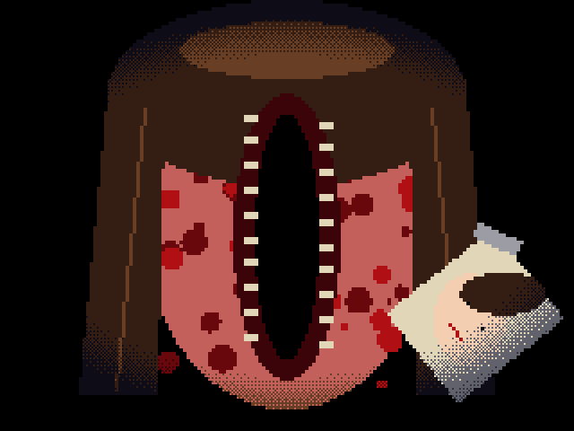 |

</details>

---

## 실행하기

1. **Unity Hub → Add(추가) →** 이 폴더를 선택합니다.
   - 권장 버전: **Unity 6 (6000.0 LTS)**. 프로젝트는 `6000.0.23f1`로 표시되어 있지만, 다른 6000.x 버전으로 열어도 됩니다.
   - Unity **2021.3 LTS** 이상에서도 컴파일되는 것을 확인했습니다.
2. 처음 열 때 Unity가 `Library/`와 `.meta` 파일을 만듭니다 (1~2분).
3. `Assets/Scenes/Main.unity`를 열고 **▶ Play**.
   - 씬에 아무것도 배치할 필요가 없습니다. 게임은 `RuntimeInitializeOnLoadMethod`로 **어느 씬에서든 자동으로 시작**됩니다.
   - Game 뷰는 **4:3** (예: 1280×960)이 가장 보기 좋습니다. 다른 비율이면 정수 배율로 확대하고 남는 곳은 검게 둡니다.
4. 빌드: **File → Build Profiles** (2021.3은 *Build Settings*) → `Main` 씬이 이미 등록되어 있으니 **Build**.

입력 설정(Player Settings → Active Input Handling)은 무엇이든 동작합니다.
*Input Manager (Old)* 또는 *Both*면 키보드와 게임패드, *Input System Package (New)* 만이면 키보드만 받습니다 (IMGUI 키 이벤트).

## 조작

| 키 | 동작 |
|---|---|
| 방향키 / WASD | 이동 |
| Z / Enter / Space | 조사, 대화 넘기기, 결정 |
| X / Shift (누르고 있기) | 손전등 |
| C | 손가락 세기 |
| Esc / P | 일시정지 · 취소 |
| F11 | 전체화면 전환 |

게임패드 (구 입력 사용 시): 왼쪽 스틱 이동, A 결정, B 취소, X 손전등, Y 손가락 세기, Start 일시정지.

## 플레이 팁 (스포일러 없음)

- 엄마가 말했습니다. *"가위 눌리면 손가락을 세어 봐. 꿈에서는 손가락 개수가 이상하대."*
- 꿈속에서 **C로 손가락을 세면** 꿈이라는 걸 알게 됩니다(자각). 왼쪽 위의 눈이 뜨여 있는 동안에만 보이는 것, 통하는 것이 있습니다.
- 손가락을 세는 동안에는 무방비입니다. 언제 셀지 잘 고르세요.
- 손전등은 배터리가 닳고, 끄면 다시 찹니다.
- **수면등**에 닿으면 저장됩니다. 타이틀에서 「이어하기」.
- 소리를 켜고, 가능하면 헤드폰으로.

## 이야기와 기획

전체 기획서 (제작 범위, 시스템, 아트 방향, **이야기 전개 전체 — 스포일러**): [docs/DESIGN.md](docs/DESIGN.md)

---

## 어떻게 만들었나

- 게임 로직과 렌더러는 **UnityEngine에 의존하지 않는 순수 C#** 입니다. 320×240 **8비트 인덱스 컬러 프레임버퍼**(32색 팔레트)에 직접 그리고, Unity 층은 그 화면을 텍스처로 올리고 소리를 재생할 뿐입니다.
- 월드는 160×120으로 그려 2배로 키웁니다(큰 픽셀). 어둠은 4×4 베이어 디더링 단계로 표현합니다.
- **모든 그림은 코드**입니다: 스프라이트는 소스 안의 아스키 아트, 컷신은 절차적 드로잉(12fps로 끊어서 손으로 그린 듯하게).
- **모든 소리도 코드**입니다: 드론, 오르골 자장가(창작 멜로디), 추격 음악, 효과음 30여 종, 그리고 **한글 자모 단위 포먼트 합성**으로 만든 속삭임·악마·아이들 목소리.
- 외부 에셋은 한글 비트맵 폰트(갈무리) 하나뿐입니다.
- Unity가 없어도 `Tools/Harness`(.NET 콘솔)로 게임을 그대로 돌려 스크린샷을 찍고 자동 플레이 테스트를 할 수 있습니다.

## 폴더 구조

```
Assets/
  Scenes/Main.unity        빈 씬 (빌드용). 게임은 자동으로 시작된다.
  Resources/Fonts/         갈무리 비트맵 폰트 (.bytes로 변환한 것) + OFL 라이선스
  Scripts/
    Engine/                순수 C# 엔진
      Pal.cs                 32색 팔레트, 어둠 단계 램프
      Canvas.cs              인덱스 컬러 프레임버퍼와 그리기 (도형, 디더링, 스프라이트)
      Sprite.cs              아스키 스프라이트
      BitmapFont.cs          한글 비트맵 폰트
      Scripts.cs             코루틴 스크립트 실행기 (이벤트, 컷신)
      Audio/                 실시간 합성: 효과음, 음악, 목소리, 믹서
    Game/                  게임 (역시 순수 C#)
      GameCore.cs            상태 스택, 저장, 대화, 화면 효과
      MenuStates.cs          경고, 타이틀, 설정, 일시정지
      World/                 방, 플레이어, 조명, 피, HUD, 방 지도(Rooms.cs)
      Monsters/              가위, 손가락 무리, 엄마인 척하는 것, 얼굴 없는 아이들
      Story/                 이야기 (방별 배치, 이벤트, 피날레)
      Cutscenes/             절차적 컷신 (가위눌림, 손가락, 사망, 사진, TV, 보스, 엔딩, 크레딧)
      Art/                   스프라이트 모음, 큰 그림 도우미
    Unity/                 Unity 연결층 (부팅, 화면, 입력, 오디오, PlayerPrefs 저장)
Tools/
  Harness/                 Unity 없이 게임을 돌리는 .NET 8 콘솔
  UnityCheck/              Unity 참조 어셈블리로 컴파일 검사
  FontBake/                BDF → .bytes 폰트 변환
docs/
  DESIGN.md                기획서
  screenshots/
```

## 고치고 늘리기

- **방 지도** — `Assets/Scripts/Game/World/Rooms.cs`의 아스키 지도. 한 칸 = 4px.
  `#` 벽 윗면, `F` 벽 앞면, `W` 창문, `.` 장판, `,` 타일, `_` 깔개, `~` 핏물, `s` 계단, `o` 구멍, `0`~`9` 출구(`RoomDef.Exits`).
  방 이름 접두사: `r_` 현실(프롤로그), `d_` 꿈, `m_` 아침(엔딩).
- **소품 · 이벤트 · 대사** — `Assets/Scripts/Game/Story/`
  `Story.cs`(방마다 소품과 밟으면 일어나는 구역), `StoryEvents.cs`(프롤로그 ~ 꿈 진입), `StoryFinale.cs`(사진 ~ 엔딩).
  이벤트는 C# 코루틴입니다: `yield return g.Say(Speaker.Think, "…");`, `yield return g.Ask(질문, 선택지, 콜백);`, `yield return g.PlayCutscene(new TvCutscene());`
- **스프라이트** — `Assets/Scripts/Game/Art/Sprites.cs`. 글자 하나가 픽셀 하나이고, 파일 맨 위 주석에 문자 → 색 표가 있습니다.
- **소리** — `Engine/Audio/SoundBank.cs`(효과음), `MusicGen.cs`(음악), `Voice.cs`(목소리 합성).
- **크레딧** — `Assets/Scripts/Game/Cutscenes/Cutscenes2.cs`의 `CreditsState`. 제작자 표기가 임시로 **「404호 작업실」** 이니 원하는 이름으로 바꾸세요.

## 개발 도구 (Unity 없이)

[.NET 8 SDK](https://dotnet.microsoft.com/download)가 필요합니다.

```bash
cd Tools/Harness/Runner
dotnet build -c Release
dotnet bin/Release/net8.0/GawiHarness.dll <명령>     # 결과는 Tools/Harness/out/
```

| 명령 | 내용 |
|---|---|
| `play [shots] [hard]` | 새 게임부터 크레딧까지 **자동 플레이**. 기본은 무적, `hard`는 죽을 수 있는 모드, `shots`는 장면마다 스크린샷 |
| `shots` | 주요 장면 스크린샷 |
| `rooms` | 모든 방 렌더 |
| `cutscenes [이름]` | 컷신을 프레임별 PNG로 |
| `bosstest` / `momtest` | 보스전 / 부엌 잠입만 따로 테스트 |
| `fuzz [초]` | 방마다 무작위 입력을 퍼부어 예외 검사 |
| `audio [wav]` | 모든 소리 합성 검사 (`wav`면 WAV 파일로 저장) |
| `engine` | 엔진 그리기 테스트 이미지 |

**Unity 컴파일 검사** (Unity 설치 불필요, 참조 어셈블리를 내려받아 씀):

```bash
Tools/UnityCheck/check.sh
```

Unity 6000.0.23(구 입력 / 신 입력)과 2021.3.45에서, 경고도 오류로 취급해 `Assets/Scripts` 전체를 컴파일합니다.

**폰트 다시 변환**: `python3 Tools/FontBake/bake_font.py Galmuri11.bdf Assets/Resources/Fonts/galmuri11.bytes` (BDF는 npm 패키지 `galmuri`에 들어 있습니다)

## 검증한 것과 한계

검증한 것:

- 자동 플레이: 새 게임 → 프롤로그 → 가위눌림 → 꿈 → 사진 조각 3개 → 계단 추격 → 보스 → 엔딩 → 크레딧 → 타이틀까지 끊김 없이 진행 (무적 모드와 `hard` 모드 모두).
- 모든 방에서 무작위 입력 퍼징: 예외 없음.
- Unity 6000.0.23 / 2021.3.45 참조 어셈블리로 컴파일: 오류·경고 없음.

한계:

- 이 저장소를 만든 환경에는 Unity 에디터가 없어서, **Unity 층(`Assets/Scripts/Unity`)은 컴파일까지만 확인**했습니다. 게임 로직·그림·소리는 하네스에서 직접 돌려 확인했습니다.
- 게임패드는 구 입력(Input Manager)을 쓸 때만 동작합니다. 키 재설정 UI는 없습니다.
- 한국어만 있습니다. 2장 이후 이야기는 아직 없습니다.

## 크레딧 · 라이선스

- 한글 비트맵 폰트: **갈무리 (Galmuri)** © 2019–2025 이민서 (Lee Minseo), [SIL Open Font License 1.1](Assets/Resources/Fonts/Galmuri-OFL-LICENSE.txt). BDF를 게임용 형식으로 변환해 포함했습니다.
- 영감을 준 게임: *FAITH* (Airdorf Games). 그 게임의 그림·소리·코드는 쓰지 않았습니다.
- 그 밖의 그림, 소리, 코드는 모두 이 저장소에서 새로 만든 것입니다.
